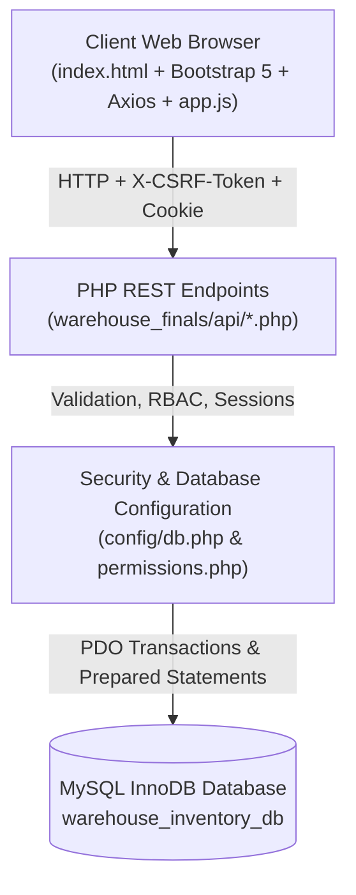
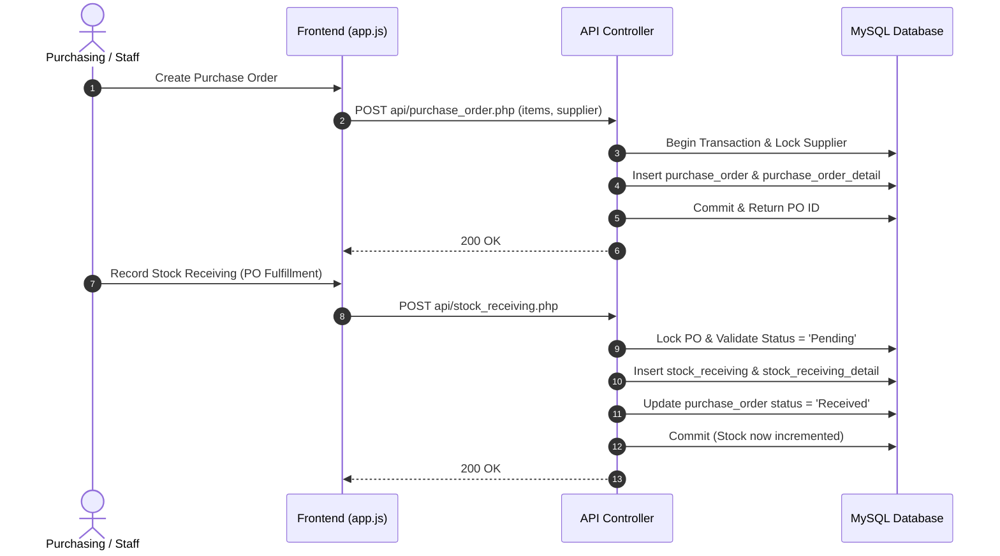

# System Architecture & Data Flow

Connected to: [[00_Project_Overview_&_Graph_Hub]], [[02_Critical_Security_Vulnerabilities]], [[04_API_&_Schema_Mismatches]]

---

## 🏗️ Architecture Blueprint

The application is structured into a 3-tier architecture:

### 1. Presentation Tier (`warehouse_finals/index.html` & `warehouse_finals/js/app.js`)
- Single Page Application (SPA) architecture driven by vanilla JavaScript.
- Uses Axios for HTTP communication and Bootstrap 5 for UI styles.
- Employs HTML `<template>` tags to dynamically instantiate table rows and badges.
- Implements declarative modal triggers and tab switching.

### 2. Application & API Tier (`warehouse_finals/api/*.php`)
- Modular PHP scripts handling REST endpoints.
- **Master Data APIs**:
  - `category.php` (Product Categories)
  - `product.php` (Inventory Catalog)
  - `supplier.php` (Vendor Management)
  - `product_supplier.php` (Pricing & Vendor Matrix)
  - `role.php` (RBAC Security Principals)
  - `users.php` (User Accounts & Password Management)
- **Transaction APIs**:
  - `purchase_order.php` (PO Creation & Cancellation)
  - `stock_receiving.php` (Stock Inbound Fulfillment)
  - `stock_releasing.php` (Stock Outbound Requisitions)
  - `purchase_return.php` (Returns to Vendor)
  - `stocks_return.php` (Internal Restock Returns)
  - `adjustment.php` (Physical Inventory Variance)
- **Authentication & Security API**:
  - `auth.php` (Session verification, login rate-limiting, and authentication)

### 3. Data & Storage Tier (`warehouse_finals/database.sql`)
- MySQL InnoDB database engine with strict foreign key constraints.
- Real-time stock calculation computed dynamically via `productStock()`:
  $$\text{Current Stock} = (\text{Received} + \text{Returned by Store} + \text{Adjust Additions}) - (\text{Released} + \text{Returned to Vendor} + \text{Adjust Deductions})$$
- Pessimistic concurrency control with `SELECT ... FOR UPDATE` row locks.

---

## 🔁 Transaction Flow

See related issues in [[03_Fatal_Frontend_Runtime_Errors]] and [[04_API_&_Schema_Mismatches]].
