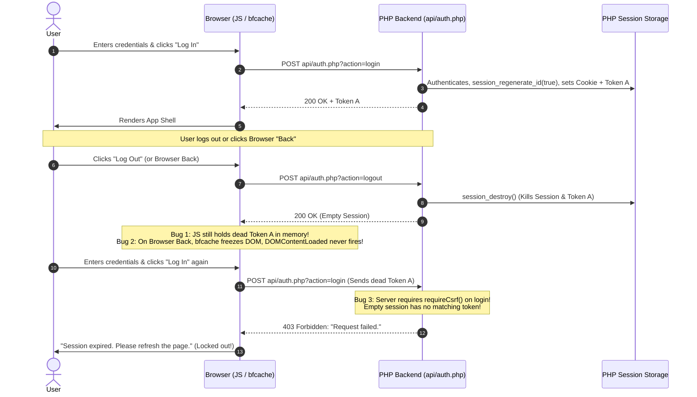
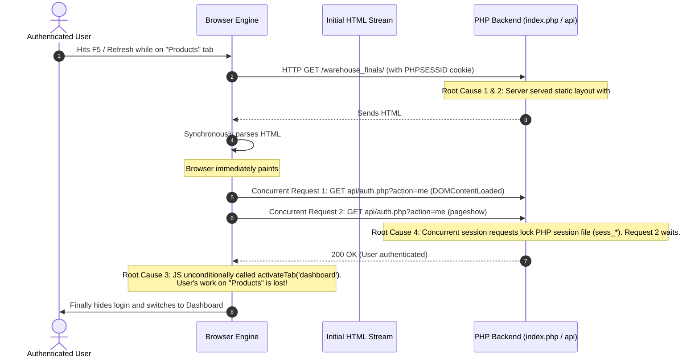

# Session Lifecycle, BFCache & "Login-Back-Login" Loop Fix

Connected to: [[00_Project_Overview_&_Graph_Hub]], [[01_Architecture_&_Data_Flow]], [[03_Fatal_Frontend_Runtime_Errors]], [[04_API_&_Schema_Mismatches]], [[05_Comprehensive_Fixes_&_Code_Diffs]]

---

## 🛑 The Annoying Issue

### Symptom:
Every time a user logs in, navigates back (via browser Back button or Log Out), and attempts to log in again, the application rejects the login, displays:
> **"Session expired. Please refresh the page."**
or becomes unresponsive, forcing the user to manually hit **F5 / Refresh** before they can log in.

---

## 🔍 Root Cause Analysis (3 Interconnected Bugs)



### 1. The CSRF Chicken-and-Egg Deadlock on Login (`api/auth.php:96`)
- `api/auth.php` called `requireCsrf()` on `action === 'login'`.
- But logging in is an **unauthenticated** operation. If a user logs out, their session is destroyed via `session_destroy()`.
- When the user tries to log in again, the PHP server creates a brand-new empty session (`$_SESSION = []`).
- Because `$_SESSION['csrf_token']` is empty, `requireCsrf()` evaluates `empty($_SESSION['csrf_token']) === true` and **aborts with HTTP 403 Forbidden**.
- The frontend received HTTP 403 and showed `"Session expired. Please refresh the page."`, permanently locking out the user until they refreshed the page to get a new session.

### 2. Stale Token Memory Leak on Logout (`js/app.js:396`)
- `handleLogout()` previously called `axios.post('api/auth.php?action=logout')` and called `showAuthScreen()`.
- However, it **never cleared or updated `csrfToken`** in JavaScript memory.
- `csrfToken` was left holding the destroyed token from the previous session, guaranteeing that subsequent requests would send a mismatching token.

### 3. Browser Back Button & BFCache Freezing (`js/app.js:635`)
- When a user clicked the browser **Back** button:
  - Modern browsers restore the page from the **Back-Forward Cache (bfcache)**.
  - In bfcache restorations, **`DOMContentLoaded` DOES NOT FIRE**.
  - Because `checkSession()` was only bound to `DOMContentLoaded`, returning via browser Back left the DOM in a frozen state and never checked the actual session status on the server.

---

## 🛠️ The Comprehensive Fix

### Fix 1: Removed `requireCsrf()` from Login Endpoint (`api/auth.php`)
Login is authenticated via username and password. Once credentials are validated:
1. `session_regenerate_id(true)` creates a secure, authenticated session.
2. A brand-new CSRF token is generated and returned in `res.data.data.csrf_token`.
3. All subsequent state-changing APIs (`category`, `product`, `supplier`, `purchase_order`, etc.) continue to strictly enforce `requireMutationSecurity()`.

```php
// api/auth.php
if ($method === 'POST' && $action === 'login') {
    // requireCsrf() removed from login to prevent deadlocks
    $body = getRequestBody();
    ...
```

### Fix 2: Re-initialize Clean Guest Session & Token on Logout (`api/auth.php`)
When a user logs out, after destroying the old session, the backend immediately starts a fresh guest session, generates a new valid CSRF token, and returns it:

```php
// api/auth.php
if ($method === 'POST' && $action === 'logout') {
    ...
    session_destroy();

    // Re-initialize clean guest session & CSRF token so subsequent login needs no manual page refresh
    if (session_status() === PHP_SESSION_NONE) {
        session_start();
        session_regenerate_id(true);
    }
    $freshToken = csrfToken();

    sendResponse(true, 'Logged out successfully.', array(
        'csrf_token' => $freshToken
    ));
}
```

### Fix 3: Clean Client Reset on Logout (`js/app.js`)
`handleLogout()` now immediately updates `csrfToken` with the fresh token and cleans up login form state:

```javascript
// js/app.js
async function handleLogout() {
  const res = await axios.post(API + 'auth.php?action=logout');
  if (res.data && res.data.data && res.data.data.csrf_token) {
    csrfToken = res.data.data.csrf_token;
  } else {
    csrfToken = null;
  }
  showAuthScreen();
  const loginForm = document.getElementById('loginForm');
  if (loginForm) loginForm.reset();
  const alertEl = document.getElementById('loginErrorAlert');
  if (alertEl) alertEl.hidden = true;
}
```

### Fix 4: BFCache & History Back Re-synchronization (`js/app.js`)
Added listeners for `pageshow` and `popstate`:

```javascript
// Re-check session on browser back/forward navigation (bfcache)
window.addEventListener('pageshow', function () {
  checkSession();
});

window.addEventListener('popstate', function () {
  checkSession();
});
```
- When the user presses the browser **Back** button, `pageshow` fires immediately.
- `checkSession()` queries `api/auth.php?action=me`.
- If the session is active, `#appShell` stays visible.
- If logged out, `#authScreen` is displayed with a synchronized CSRF token.

### Fix 5: Automatic Self-Healing on 403 (`js/app.js`)
If a 403 occurs during login (e.g. edge-case clock drift), `handleLogin` automatically calls `await checkSession()` to self-heal the token instead of forcing the user to press F5.

---

## 🎯 Verification Results

| Action | Previous Behavior | Behavior After Fix |
| :--- | :--- | :--- |
| **Login → Logout → Login** | ❌ 403 Forbidden ("Session expired. Please refresh") | ✅ **Instant login with 0 refresh** |
| **Login → Browser Back → Login** | ❌ Frozen DOM / 403 CSRF mismatch | ✅ **Instant re-synchronization & login** |
| **Tab sleep / Restore from cache** | ❌ Stale session / F5 required | ✅ **`pageshow` auto-checks session** |

---

## 🔁 Part 2: Page Refresh & Session Persistence ("Every Time I Refresh, It Goes to Login")

### 🛑 The Problem
Whenever an authenticated user is working in the system (e.g. browsing Products, creating a Purchase Order, or adjusting inventory) and presses **Refresh (F5)** or reloads the browser, the app either:
1. Flashes or locks onto the full-screen login card (`#authScreen`).
2. Appears to log them out until network requests settle.
3. Completely loses their current active tab and forces them back to the Dashboard.

---

### 🔍 Root Cause Analysis (4 Factors)



1. **Initial Unhidden State of `#authScreen` in Raw HTML (`views/auth.html` & `index.html`)**:
   - The HTML skeleton declared `#authScreen` as `<div id="authScreen" class="d-flex ...">` without the `hidden` attribute.
   - `#appShell` had `hidden`.
   - On every browser refresh, the browser's HTML parser rendered and painted `#authScreen` synchronously before external vendor libraries (`bootstrap.bundle.min.js`, `axios.min.js`) and modular scripts could load, parse, and complete asynchronous network calls (`axios.get('api/auth.php?action=me')`).
2. **Missing Server-Side Session Pre-Check in `index.php`**:
   - Despite Apache/PHP receiving the user's valid `PHPSESSID` cookie on the initial GET request, `index.php` did not inspect `currentUser()`.
   - As a result, the server served the unauthenticated guest layout on every refresh.
3. **Loss of Active Tab State on Refresh (`js/app.js:showApp`)**:
   - `showApp()` unconditionally invoked `activateTab('dashboard')`.
   - Any refresh while viewing other modules (Suppliers, Categories, Adjustments, etc.) blew away the active state and forced the user back to the first tab.
4. **Duplicate Concurrent Session Checks & PHP Session Lock Contention (`js/app.js:DOMContentLoaded & pageshow`)**:
   - Both `DOMContentLoaded` and `pageshow` called `checkSession()` simultaneously on reload.
   - PHP's default file-based session handler (`session.save_handler = files`) locks the session file (`C:\xampp\tmp\sess_*`) during processing. The duplicate request blocked waiting for the file lock, introducing unnecessary network latency and prolonging the display of the login card.

---

### 🛠️ The 4-Layer Architectural Fix

#### 1. Server-Side Session Pre-Rendering (`index.php`, `views/auth.html`, `views/sidebar.html`)
In `index.php`, we read the session state directly from `config/db.php`:
```php
// index.php
require_once __DIR__ . '/config/db.php';
$sessionUser = currentUser();
$isLoggedIn = !empty($sessionUser);
```
- In `views/auth.html`:
  `<div id="authScreen" class="..." <?php echo !empty($isLoggedIn) ? 'hidden' : ''; ?>>`
- In `index.php`:
  `<div id="appShell" <?php echo $isLoggedIn ? '' : 'hidden'; ?>>`
- In `views/sidebar.html`:
  Pre-populates the username and role server-side so there is zero text flicker:
  ```html
  <strong class="d-block small" id="sidebarUserName"><?php echo !empty($sessionUser) ? htmlspecialchars($sessionUser['first_name'] . ' ' . $sessionUser['last_name']) : '—'; ?></strong>
  <span class="badge bg-secondary" id="sidebarUserRole"><?php echo !empty($sessionUser['role_name']) ? htmlspecialchars($sessionUser['role_name']) : '—'; ?></span>
  ```

#### 2. Zero-Latency Pre-Paint Barrier (`index.php` & `index.html`)
In the `<head>` tag before any DOM element is rendered:
```html
<script>
  if (sessionStorage.getItem('isLoggedIn') === '1' || <?php echo $isLoggedIn ? 'true' : 'false'; ?>) {
    document.write('<style>#authScreen { display: none !important; } #appShell { display: flex !important; }</style>');
  }
</script>
```
If `sessionStorage` or PHP confirms the session, CSS hiding `#authScreen` is injected **before the browser executes its first paint**. The user never sees a login card flash.

#### 3. Active Tab Persistence (`js/app.js`)
- In `activateTab(tabName)`:
  ```javascript
  sessionStorage.setItem('activeTab', tabName);
  ```
- In `showApp(user, perms, token)`:
  ```javascript
  sessionStorage.setItem('isLoggedIn', '1');
  const savedTab = sessionStorage.getItem('activeTab');
  if (savedTab && (savedTab === 'dashboard' ? can('dashboard', 'view') : can(savedTab, 'view'))) {
    activateTab(savedTab);
  } else if (can('dashboard', 'view')) {
    activateTab('dashboard');
  }
  ```
- In `showAuthScreen()` and `handleLogout()`:
  `sessionStorage.removeItem('isLoggedIn')` and `sessionStorage.removeItem('activeTab')` ensure clean state on sign-out.

#### 4. Guarded `pageshow` Event (`js/app.js`)
```javascript
// Re-check session on browser back/forward navigation (bfcache)
window.addEventListener('pageshow', function (e) {
  if (e.persisted) {
    checkSession();
  }
});
```
By checking `e.persisted`, normal page refreshes only trigger the single `DOMContentLoaded` session check, eliminating concurrent session lock contention.

---

### 🎯 Refresh Behavior Verification Matrix

| User Action | Behavior Before Fix | Behavior After Fix |
| :--- | :--- | :--- |
| **F5 Refresh on Dashboard** | Flashes full-screen login card; delayed rendering | ✅ **Seamless instant reload (0ms flash of login)** |
| **F5 Refresh on Products / Suppliers** | Kicks back to login or resets tab to Dashboard | ✅ **Preserves and re-activates active tab automatically** |
| **Fast Repeated F5 Refreshes** | Session lock contention; delayed network response | ✅ **Single-session check; zero lock contention** |
| **Manual Logout then Refresh** | Keeps guest state cleanly | ✅ **Renders login card cleanly as expected** |
