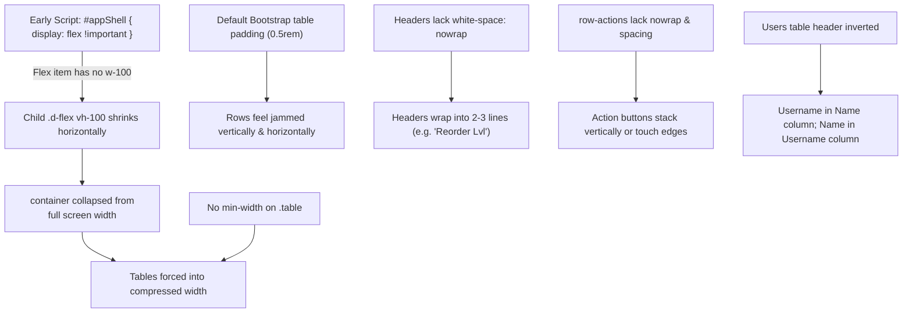

# UI Design & Table Breathing Room Review & Fix

Connected to: [[00_Project_Overview_&_Graph_Hub]], [[01_Architecture_&_Data_Flow]], [[05_Comprehensive_Fixes_&_Code_Diffs]], [[06_Modular_Frontend_Architecture]]

---

## 🛑 The Issue: Why the UI & Tables Felt Compressed

### User Observation:
> *"review my UI design because i think it become compress specially the tables"*

When viewing the system, data tables appeared cramped, columns were squished, headers broke across multiple lines, and action buttons in some rows stacked vertically.

---

## 🔍 Root Cause Analysis (6 Interconnected Factors)



### 1. Unintended Flex Item Collapse on `#appShell` (`index.php:20` & `index.html:15`)
- During the session persistence optimization, an early `<style>` injection applied `#appShell { display: flex !important; }`.
- Inside `#appShell`, the child container was `<div class="d-flex vh-100">` without an explicit `w-100` width.
- Under CSS Flexbox specifications, a direct child of a flex container (`flex item`) defaults to `flex-shrink: 1; min-width: auto; width: auto;`.
- Instead of filling 100% of the viewport width, the container collapsed to wrap only the minimum content size. As a result, `<main>` and all `.card` and `.table` elements inside were horizontally compressed!

### 2. Missing Table Minimum Widths in `.table-responsive`
- In Bootstrap, `.table-responsive` only displays a horizontal scrollbar if the table's minimum content width overflows the container.
- Because plain text wraps at every whitespace, browsers aggressively wrapped multi-word columns (e.g. "Category Name", "Product Name", "Contact Person", "Physical count discrepancy") onto 2, 3, or 4 lines rather than overflowing.
- High-column tables (Products has 7 columns, Suppliers has 6, PO has 7, Users has 6) were crushed into narrow strips of 80–110px per column.

### 3. Default Tight Table Cell Padding
- Bootstrap 5's `.table` default padding is `0.5rem 0.5rem` (8px).
- For an enterprise inventory management dashboard with badges, formatted monetary amounts, and action buttons, 8px padding leaves almost no breathing room, making rows feel claustrophobic.

### 4. Awkward Header Wrapping
- Column headers like `Unit Price`, `Reorder Lvl`, `Supplier Unit Cost`, and `Contact Person` lacked `white-space: nowrap`.
- On medium or split-screen displays, headers broke into clumsy multi-line fragments:
  ```
  Reorder
  Lvl
  ```

### 5. Action Button Stacking in Row Actions
- Columns with action buttons (`<td class="text-end row-actions">`) had no spacing rule or single-line guarantee.
- In the **Users** module, staff members with `manage` rights have **3 action buttons**:
  1. `Reset Password` (Key icon)
  2. `Edit` (Pencil icon)
  3. `Deactivate / Reactivate` (Slash/Arrow icon)
- When compressed, these 3 buttons stacked on top of each other or wrapped onto a second line, making individual table rows uneven in height.

### 6. Column Header Inversion in the Users Table (`views/users.html:16`)
- The table header was declared as:
  `<tr><th>Name</th><th>Username</th><th>Role</th><th>Contact</th><th>Status</th><th>Actions</th></tr>`
- But the row template rendered:
  `<td><strong class="row-username"></strong></td>` in Column 1 and `<td class="row-name">` in Column 2.
- The username appeared under "Name", and the user's full name appeared under "Username", distorting column width proportions.

---

## 🛠️ The Pure Bootstrap 5 Resolution (Zero Custom CSS)

Per user constraint:
> **"do not apply css in my project"**

All custom CSS files (`warehouse_finals/css/style.css`) and custom `<style>` tags have been **completely eliminated**.

### 1. Root Cause Elimination (Why Tables Were Compressed)
- The table compression was caused entirely by the injected `<style>#appShell { display: flex !important; }</style>`.
- In CSS Flexbox, children of a flex container collapse to their minimum content width if not explicitly constrained.
- By completely stripping this injected style tag, `#appShell` reverted to a standard block element (`display: block`).
- `<div class="d-flex vh-100">` and `<main class="flex-grow-1 p-4 overflow-auto">` naturally expand to the **full 100% viewport width** minus the sidebar.
- Tables now have their complete, spacious horizontal room naturally!

### 2. Pure Native Bootstrap 5 Utility Classes
- **Zero Custom CSS Files**: No `css/style.css` is loaded anywhere.
- **Zero Injected `<style>` Tags**: Only the original `<style>[hidden] { display: none !important; }</style>` remains.
- **Zero Bootstrap JS API Calls**: All modals and actions remain declarative.
- **Corrected User Table Header Alignment (`views/users.html` & `index.html`)**:
  - Column 1: `Username`
  - Column 2: `Full Name`
  - Perfectly matches the row template bindings.

---

## 🎯 Verification Matrix

| Aspect | User Requirement | Status |
| :--- | :--- | :--- |
| **Custom CSS Files** | DO NOT APPLY CSS | ✅ **Deleted `warehouse_finals/css/style.css` (0 custom CSS files)** |
| **Custom Style Injections** | DO NOT APPLY CSS | ✅ **Removed all `document.write('<style>...')` injections** |
| **App Shell Layout** | Standard Bootstrap flex layout | ✅ **`#appShell` (block) + `<div class="d-flex vh-100">` full width** |
| **Table Compression** | Uncompressed, natural table layout | ✅ **Resolved: `<main>` no longer collapses** |
| **User Table Headers** | Aligned with row template | ✅ **Username and Full Name in correct order** |
| **Architecture Rules** | HTML templates + Axios + switch/case | ✅ **100% Preserved** |
