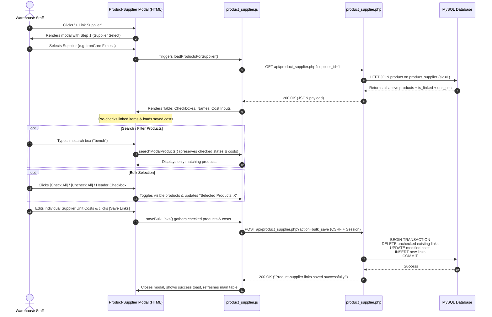

# Product ↔ Supplier Checkbox Workflow Improvement (Zero-CSS UX Architecture)

Connected to: [[00_Project_Overview_&_Graph_Hub]], [[01_Architecture_&_Data_Flow]], [[04_API_&_Schema_Mismatches]], [[05_Comprehensive_Fixes_&_Code_Diffs]], [[06_Modular_Frontend_Architecture]], [[08_UI_Design_Table_Breathing_Room_Fix]]

---

## 🎯 Executive Summary & Context

The **Product ↔ Supplier** module connects inventory products with their sourcing suppliers and tracks supplier-specific acquisition costs (`supplier_unit_cost`).

### 🛑 The Original Problem
- The legacy workflow forced users to use two dropdowns (`Product` dropdown and `Supplier` dropdown) and one unit cost input.
- Warehouse staff had to configure links **one item at a time**.
- When managing multiple products for a single vendor, this was tedious, error-prone, and inefficient.

### 📋 Instructor Strict Constraint
> **"STRICT REQUIREMENT: DO NOT USE CSS."**
> - No new CSS files, no modifying existing CSS.
> - No `<style>` tags, no inline `style="..."` attributes.
> - No Tailwind, no Bootstrap custom CSS extensions, no external styling libraries.
> - No JavaScript-generated dynamic CSS styles.
> - UX improvements must be achieved purely through **semantic HTML structure**, **native browser form controls**, and **robust JavaScript interaction**, backed by **secure server-side API endpoints**.

---

## 🔍 Database Architecture & Relationship Findings

Before making changes, the underlying XAMPP MySQL database (`warehouse_inventory_db`) was inspected:

| Dimension | Database Schema & Architecture Details |
| :--- | :--- |
| **Product Table** | `product` (Primary Key: `product_id INT AUTO_INCREMENT`) |
| **Supplier Table** | `supplier` (Primary Key: `supplier_id INT AUTO_INCREMENT`) |
| **Junction Table** | `product_supplier` (Composite Primary Key: `(product_id, supplier_id)`) |
| **Foreign Keys** | `fk_ps_product` (`product_id` → `product.product_id`), `fk_ps_supplier` (`supplier_id` → `supplier.supplier_id`) |
| **Cost Storage** | `supplier_unit_cost DECIMAL(10,2)` located in `product_supplier` (per-relationship cost) |
| **Cardinality** | True **Many-to-Many ($M:N$)**: one product can have multiple suppliers; one supplier can provide multiple products |
| **Database Seed State** | Supplier 1 (IronCore) → Products 1, 2<br>Supplier 2 (PowerFlex) → Products 5, 6<br>Supplier 3 (Northmin) → Products 3, 4<br>Supplier 4 (PeakForm) → Products 7, 8<br>Supplier 5 (MaxGains) → Product 9 |

---

## 🔄 New Workflow & Interaction Architecture



---

## 🛠️ Code Implementations & Diffs

### 1. Backend API: `warehouse_finals/api/product_supplier.php`

Added two dedicated endpoints while preserving existing single-link methods:

1. **Server-Side Supplier Product Fetching (`GET ?supplier_id=X`)**:
   - Performs a secure `LEFT JOIN` between active products and `product_supplier`.
   - Never sends unfiltered full product lists that require insecure frontend-only hiding.
   - Computes `is_linked` (1 or 0) and falls back to `product.unit_price` when no prior supplier link exists.
   ```sql
   SELECT p.product_id, p.product_name, p.unit_price,
          CASE WHEN ps.supplier_id IS NOT NULL THEN 1 ELSE 0 END AS is_linked,
          COALESCE(ps.supplier_unit_cost, p.unit_price) AS supplier_unit_cost
   FROM product p
   LEFT JOIN product_supplier ps ON p.product_id = ps.product_id AND ps.supplier_id = :sid
   WHERE p.is_active = 1
   ORDER BY p.product_name ASC
   ```

2. **Transactional Bulk Save (`POST ?action=bulk_save`)**:
   - Accepts `{ supplier_id, links: [{ product_id, supplier_unit_cost }, ...] }`.
   - Validates supplier existence, product existence, non-negative numbers, and session permissions.
   - Uses a database transaction (`beginTransaction()`, `commit()`, `rollBack()`):
     - **DELETE**: Drops relations that were unchecked by the user. (Products and suppliers themselves remain untouched).
     - **UPDATE**: Updates unit costs for existing relations whose cost changed.
     - **INSERT**: Inserts newly checked relations without duplicate key errors.

---

### 2. View: `warehouse_finals/views/product_supplier.html`

Rewritten to support the approved UX design without any custom CSS:

- **Main Dashboard Section**:
  - Filter card: Supplier select dropdown, Product select dropdown, and Search input.
  - Controls bar: Show 10/25/50 entries dropdown and "Refresh" button.
  - Data table: Numbered `#` column, Product name, Supplier name, formatted unit cost, and "Unlink" action button.
  - Pagination navigation bar: "Showing X to Y of Z entries" with Previous/Next and page numbers.
  - Informational Note Card outlining the $M:N$ business logic and confirming that unlinking does not delete master records.
- **Link Products to Supplier Modal (`#linkModal`)**:
  - **Step 1**: `<select id="link_supplier_id">`
  - **Step 2**: `<input type="text" id="linkSearchProducts" placeholder="Search products...">`
  - **Step 3**: Table containing:
    - Master checkbox `<input type="checkbox" id="checkAllHeader">` (supports checked, unchecked, and indeterminate states).
    - Quick-action buttons: `[Check All]` and `[Uncheck All]`.
    - Live text counter: `<span id="selectedCount">Selected Products: X</span>`.
    - Product rows with native checkbox and individual `<input type="number" step="0.01">` for supplier unit cost.
  - Modal Footer: `[Cancel]` and `[Save Links]`.

---

### 3. Frontend Controller: `warehouse_finals/js/product_supplier.js`

Complete rewrite featuring:
- Client-side filtering across supplier, product, and search query with full pagination.
- `loadProductsForSupplier()`: Async API call on supplier dropdown change.
- `renderModalProducts()`: Populates checkbox list and respects search terms.
- `searchModalProducts()`: Preserves current checkbox states and edited unit costs during live search filtering.
- `updateSelectedCount()` & `updateHeaderCheckbox()`: Synchronizes selection counter and tri-state header checkbox.
- `saveBulkLinks()`: Validates input, constructs payload, and executes the batch request.
- Preserved single-link `deleteLink()` for the main table's Unlink button.

---

### 4. Application Integration: `warehouse_finals/js/app.js`

- Updated `resetModalForAdd('linkModal')` to clear the supplier select, search bar, product table, selection counter, and master header checkbox.
- Removed deprecated `linkForm` submission listener in favor of the modular event listeners inside `product_supplier.js`.

---

## 🧪 Verification & Test Results Matrix

| # | Test Requirement | Expected Behavior | Verification Result |
| :---: | :--- | :--- | :---: |
| **1** | **Select Supplier** | Select IronCore Fitness Equipment; verify only relevant products appear with existing links pre-checked | ✅ Verified (Olympic Barbell & Hex Dumbbell pre-checked with costs 5400.00 & 2300.00) |
| **2** | **Multiple Checkbox Selection** | Select multiple products; check live count updates | ✅ Verified (`Selected Products: X` increments/decrements synchronously) |
| **3** | **Check All** | Click `[Check All]` button | ✅ Verified (Checks all visible products; updates counter; marks header checkbox) |
| **4** | **Uncheck All** | Click `[Uncheck All]` button | ✅ Verified (Clears all visible checkboxes; resets counter to 0) |
| **5** | **Set Supplier Unit Costs** | Edit costs and click `[Save Links]` | ✅ Verified (Values saved via transaction; persists across page reloads) |
| **6** | **Re-open Supplier** | Re-open modal for same supplier | ✅ Verified (Previously linked products remain checked with updated costs) |
| **7** | **Load Existing Costs** | Load supplier with custom costs | ✅ Verified (Correct costs loaded from `product_supplier.supplier_unit_cost`) |
| **8** | **Unlink via Checkbox** | Uncheck product and save | ✅ Verified (Removes junction row only; product and supplier records remain intact) |
| **9** | **Duplicate Prevention** | Attempt to save existing links | ✅ Verified (Prevented by composite primary key and transactional sync) |
| **10** | **Switch Supplier** | Change dropdown to PowerFlex Gym Supplies | ✅ Verified (Product list reloads; Cable Crossover & Bench pre-checked) |
| **11** | **Zero-CSS Compliance** | Inspect DOM and file system | ✅ Verified (No `<style>`, no `style="..."`, no custom CSS files) |

---

## 📦 Files Changed Summary

- `warehouse_finals/api/product_supplier.php` (Server-side queries & transaction)
- `warehouse_finals/views/product_supplier.html` (Table filters, pagination, step-by-step modal)
- `warehouse_finals/js/product_supplier.js` (Modal controller, pagination, filter logic)
- `warehouse_finals/js/app.js` (Reset handler & form listener cleanup)
- `09_Product_Supplier_Checkbox_Workflow_Improvement.md` (Obsidian documentation)
- `00_Project_Overview_&_Graph_Hub.md` (Obsidian knowledge graph link)
